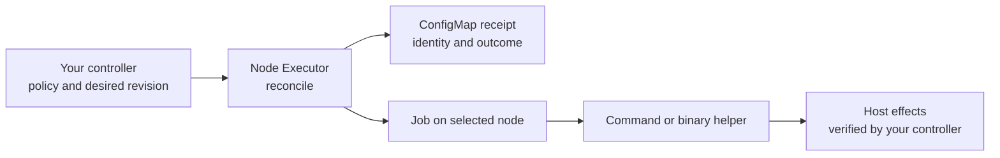

# Node Executor

Run commands and install binaries on Kubernetes nodes from a Go controller.
Node Executor handles the per-node Job and its execution record, so controllers
can share that machinery while keeping their own deployment and upgrade policies.

The entry point is one non-blocking call:

```go
run, err := executor.Reconcile(ctx, owner, nodeexec.Operation{
    Name:     "prepare-node",
    Revision: desiredRevision,
    Node:     corev1.ObjectReference{Name: node.Name, UID: node.UID},
    Template: nodeexec.Command(imageDigest, "/usr/local/bin/prepare-node"),
})
```

`Template` is a native Kubernetes `PodTemplateSpec`. Existing volume, resource,
security-context, environment, and affinity settings remain available.
The command runs inside its image on the selected node; accessing the host
requires explicit mounts or namespaces in that template.

## Use it in a controller

Use Go 1.26 or newer and controller-runtime 0.25 with the Kubernetes 0.37 Go APIs.
Jobs use suspension and `podReplacementPolicy: Failed`; the API integration test
uses Kubernetes 1.35. The binary helper targets Linux nodes and must match their
CPU architecture. No CRD or additional controller installation is required.

Fetch the library from the public repository at a chosen commit or tag:

```sh
go get github.com/kappliance/node-executor@<commit-or-tag>
```

Create the executor once with the manager's client and **uncached** API reader:

```go
import (
    nodeexec "github.com/kappliance/node-executor"
    corev1 "k8s.io/api/core/v1"
)

executor := nodeexec.New(mgr.GetClient(), mgr.GetAPIReader(), executionNamespace)
```

The owner must exist, have a UID, and be registered in the client's scheme. A
namespaced owner must share the execution namespace. Retain a caller-owned finalizer
on that owner while commands or their external effects remain unresolved.

Use a stable operation name for a particular task on a node. Change `Revision`
when its desired work changes, including changes to referenced ConfigMaps or Secrets.
Use the same template on each reconciliation of a revision. All container images,
including init containers, must use an `@sha256:` digest reference.
Container restart overrides and restarting sidecars are rejected.
Required node-affinity terms must be nonempty; adding a target constraint must
never turn an empty, non-matching term into a matching one.

Within your reconciler, handle the requested revision and the process outcome:

```go
run, err := executor.Reconcile(ctx, owner, operation)
if err != nil {
    return ctrl.Result{}, err
}
if run.Phase == nodeexec.Unknown {
    // Persist a condition, stop automatic rollout, and resolve external effects.
    return ctrl.Result{}, nil
}
if run.Revision != operation.Revision && run.Done() && !operation.Cancel {
    return ctrl.Result{RequeueAfter: time.Second}, nil
}
if run.Revision != operation.Revision || !run.Done() {
    return run.Result, nil
}
// Succeeded means the container process completed successfully.
// Failed means it failed or the work was rejected before dispatch.
// Verify domain-specific host state before reporting the desired state as ready.
return ctrl.Result{}, nil
```

For a completed predecessor returned during an authorized revision change, requeue
once so the next reconciliation records the new revision. The
[compilable integration example](examples/controller/reconcile.go) includes this
case. `Pending` and `Running` provide a five-second requeue. `Succeeded`, `Failed`,
and `Unknown` stop polling. A running predecessor finishes before a new revision
can start; `Unknown` blocks both replay and newer revisions.

Set `Operation.Cancel = true` when your controller withdraws launch authorization,
including when its reservation expires. `Cancel` is excluded from the execution
fingerprint, so it needs no revision change and does not replace the recorded
template or revision. Keep the same owner, node identity, and operation name.

An operation with no dispatch or execution evidence returns terminal
`Failed / CancelledBeforeDispatch`, retaining any created Job's reference and
leaving it suspended. A dispatched Job still suspended returns sticky
`Unknown / AuthorizationCancelledDuringDispatch`; the SDK never releases it after
cancellation. An already released Job remains observable through process completion.
Cancellation never stops processes or replaces terminal or `Unknown` evidence,
including a predecessor's receipt, and never starts a newer requested revision.
The caller computes `Cancel` on each reconciliation; the SDK has no expiry clock.

Watch owned `batchv1.Job` and `corev1.ConfigMap` objects on your controller for
prompt updates. Register `corev1` and `batchv1` in its scheme. Grant the controller:

| Resources | Required verbs |
| --- | --- |
| `batch/jobs` | `get`, `list`, `watch`, `create`, `patch`, `delete` |
| `configmaps` | `get`, `list`, `watch`, `create`, `patch` |
| `pods` | `get`, `list` |
| `nodes` | `get` |
| Owner resource | `get`, plus your controller's own reconciliation permissions |

Node reads require cluster-scoped access. Keep Job and ConfigMap writes scoped to
the execution namespace. The controller also needs the owner's finalizer permission
when admission enforces `blockOwnerDeletion`. The library does not create namespaces
or service accounts. `Command` disables API-token automount, runs as UID 65532, drops
all capabilities, uses `RuntimeDefault` seccomp, and makes the image filesystem
read-only. Edit the native template
when your command deliberately requires different privileges or writable storage.

## Install a binary

Build a helper image for the target node architecture:

```sh
make image HELPER_IMAGE=registry.example.com/node-executor:local
# For ARM64 nodes: GOARCH=arm64 make image HELPER_IMAGE=registry.example.com/node-executor:arm64
```

Push it to your own registry and obtain its immutable digest before using it.
Replace the example references below with actual digests; no hosted helper image
is assumed.

```go
template, err := nodeexec.Install(nodeexec.Binary{
    Image:       sourceImageDigest,
    HelperImage: helperImageDigest,
    Source:      "/payload/my-tool",
    Destination: "/opt/node-tools/my-tool",
    SHA256:      binarySHA256,
    // PreviousSHA256: expectedExistingBinarySHA256, // Required for an upgrade.
})
// Check err, then use template in Operation.Template.
```

The host destination directory must already exist and be writable by root.
Installation mounts only that directory. It requires a namespace policy allowing
`hostPath` and root containers. The helper runs inside the source image, so source
images can be distroless and do not need a shell. `/tools` and `/target` are reserved
mounts. Installing directly under `/` is rejected.

The helper accepts regular files up to 256 MiB, verifies their SHA-256, writes a
temporary file in the target directory, sets mode `0755`, syncs it, atomically
renames it, then syncs the directory. A different existing binary requires its
expected `PreviousSHA256`. An already-correct binary is preserved. Source and
destination symlinks are rejected. A directory lock serializes participating
installers; other host writers must be coordinated by the caller.

Installation does not register or restart a service. A process failure can occur
after the atomic rename, for example during directory sync: inspect the destination
before deciding whether another revision is safe.

## Execution and recovery boundaries



Within the execution namespace, a logical operation is keyed by
**owner UID + node UID + operation name**. The
receipt records the revision and immutable request fingerprint. The library creates
a suspended Job, records its UID and dispatch intent, then unsuspends that same
Job. Updates use Kubernetes resource-version preconditions. Missing or replaced
issued Jobs, replaced or multiple observed Pods, or a changed node identity produce
`Unknown` rather than a replacement execution.

The ConfigMap's `receipt.json` tracks the current execution. Its `unknown.json`
slot permanently retains the first uncertain observation, including its original
revision and execution identities, even if a concurrent writer has already advanced
the primary receipt. `Result.ObservedPods` preserves up to two Pod references when
multiple Pods caused the ambiguity. Once persisted, the snapshot takes precedence
over successful primary outcomes and newer revisions. It cannot retract an outcome
already returned or atomically cancel dispatch that was already authorized before
the snapshot was persisted. ConfigMap and Job writes are separate operations.

An execution whose Pod or start has been observed is never automatically released
again if its Job is unexpectedly suspended.

Keep receipts until the owner's effects have been resolved. Deleting a receipt
removes the record that prevents replay; it is not a safe way to reset `Unknown`.
Clearing `unknown.json` is also not a safe reset.
Restrict other writers in the execution namespace. Terminal Jobs and Pods can be
cleaned up after their outcome is persisted. Jobs from previous revisions are not
automatically garbage-collected while their owner exists. The caller owns cleanup,
deletion handling, launch authorization, and any explicit retry after a known failure.

Node UID is checked before dispatch and while observing. Scheduling still uses the
node's name, so this does not fence a delayed or already-running process against a
replacement machine with that same name. Commands with privileged or confidential
host effects must enforce host identity and authorization independently.

Kubernetes [Jobs can start a program more than once](https://kubernetes.io/docs/concepts/workloads/controllers/job/#handling-pod-and-container-failures),
even with one completion and no automatic retries. Use idempotent commands or a
transactional host executor. `Succeeded` proves process completion, not host commit,
health, successful reboot, or domain-specific recovery.

The shared core owns dispatch and observations. Node selection, rollout concurrency,
cordon/drain, maintenance windows, approval, signature verification, sealed secrets,
activation, rollback, and health belong to the consuming project. Controllers such
as an installer or an upgrade controller can use this boundary through adapters;
neither existing project is migrated by this repository.

## Develop and validate

```sh
make test vet build
KUBEBUILDER_ASSETS=/path/to/envtest/binaries make test-api
```

Unit tests simulate Kubernetes objects and fault responses. API tests run a real
API server and etcd to check Job validation, UID binding, and concurrent receipt
writes; they simulate Pod completion because envtest has no Job controller or
kubelet. Installer tests write only temporary directories. The CI workflow runs
these checks and builds the scratch helper image.

Full node qualification requires an explicitly selected disposable Linux node or
VM. API tests and image builds do not establish host activation, runtime restart,
reboot recovery, or compatibility with a particular node OS.

Licensed under [Apache-2.0](LICENSE).
